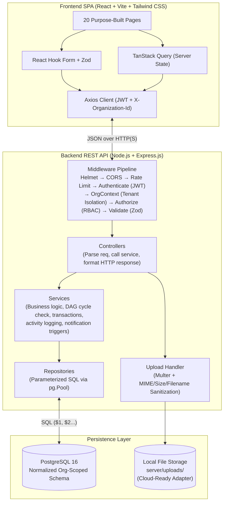

# FieldLedger — System Architecture & Security Design (Phase 1)

## 1. Product Purpose & Problem Traceability

FieldLedger is a multi-tenant **Project Management & Field Operations Platform** built for organizations that coordinate distributed teams, budgets, resources, risks, and real-world field activities.

| # | Operational Problem | Primary Modules Solving It |
| :-: | :--- | :--- |
| 1 | Managers cannot easily identify delayed projects | Projects (`status`, `expected_end_date`), Milestones (overdue checks), Organization & Project Dashboards ("At-Risk / Watchlist" widgets) |
| 2 | Team members lack clear task ownership & priorities | Advanced Tasks (`task_assignees`, `priority`, `due_date`, Kanban/List/Calendar views, Team Dashboard) |
| 3 | Field progress reports are scattered | Field Reports (`Draft → Submitted → Under Review → Approved / Rejected`) with evidence photos & structured challenges/resources |
| 4 | Project expenses & resources are hard to track | Budgets (`NUMERIC(14,2)`), Expenses + Receipt Uploads + Approvals, Resources + Allocations + Shortage Detection |
| 5 | Managers cannot see team workload & bottlenecks | Team Workload Analytics, Blocked task filters, Capacity/Timeline Gantt views |
| 6 | Important decisions & approvals are unrecorded | Dedicated `field_report_reviews` and `expense_approvals` audit tables + server-side `activity_logs` |
| 7 | Stakeholders lack clear visibility | `stakeholder` read-only RBAC role, Project & Org Dashboards, CSV report exports |
| 8 | Risks are discovered too late | Risk Register (`probability × impact = severity`), mitigation plans, review dates, dashboard high-risk banners |
| 9 | Documents & evidence are disorganized | `documents`, `task_attachments`, field report evidence, expense receipts with strict upload validation |
| 10 | No reliable change history | Transactional server-side `activity_logs` written by backend services on every important mutation |

---

## 2. High-Level Layered Architecture

FieldLedger separates concerns into three cleanly isolated tiers so that business rules, permissions, and data integrity are **never** left to the browser.



### Why This Layered Structure?

1. **Routes (`*.routes.js`)**: Declaratively map URL paths + HTTP verbs to their middleware chain (`authenticate`, `requireOrgMember`, `requireRole`, `validate`) and controller function. No SQL or business logic here.
2. **Controllers (`*.controller.js`)**: Thin HTTP adapters. They read `req.params`, `req.query`, `req.body`, `req.user`, `req.org`, call a service method, and return a standardized JSON response with the proper HTTP status code (`200`, `201`, `204`, etc.).
3. **Services (`*.service.js`)**: The brain of FieldLedger. Enforces domain rules (e.g., preventing circular task dependencies, checking workflow transitions on field reports, verifying budget limits, opening PostgreSQL transactions, writing `activity_logs`, and dispatching `notifications`).
4. **Repositories (`*.repository.js`)**: Pure data-access layer using `pg` parameterized queries (`$1, $2, ...`). Always requires `organizationId` for tenant-scoped queries so cross-organization leaks are structurally prevented.
5. **Schemas (`*.schema.js`)**: Zod validation schemas defining exact input shapes, types, date formats, enum values, and length limits.

---

## 3. End-to-End Request Lifecycle Example (Task Creation)

When a Project Manager creates a task in React, data travels through every safeguard:

```text
1. React Form (React Hook Form + Zod)
   └─ Validates title, priority, due_date, project_id client-side for instant UX feedback.
2. Axios HTTP Client
   └─ Sends POST /api/v1/projects/:projectId/tasks
      Headers: Authorization: Bearer <jwt>, X-Organization-Id: <orgUuid>
3. Express Security Middleware
   └─ helmet(), cors(), express.json(), rateLimiter()
4. authenticate.js
   └─ Verifies JWT signature & expiration; loads user record; attaches req.user.
5. orgContext.js
   └─ Reads X-Organization-Id, queries organization_members for (org_id, user_id);
      if not an active member -> 403 Forbidden. Attaches req.org = { id, role }.
6. authorize.js
   └─ Checks if req.org.role in ['org_owner', 'project_manager'] (or project-level manager).
      If stakeholder/unauthorized -> 403 Forbidden.
7. validate.js (Zod)
   └─ Validates req.params and req.body; strips unknown fields; returns 400 on invalid input.
8. tasks.controller.js
   └─ Calls tasksService.createTask({ orgId, projectId, actorId, payload }).
9. tasks.service.js (Inside PostgreSQL Transaction)
   └─ Verifies project belongs to orgId.
   └─ Verifies milestone & assignees belong to orgId / project.
   └─ Inserts row into tasks + task_assignees via tasks.repository.js.
   └─ Inserts audit entry into activity_logs.
   └─ Inserts task_assigned notifications for assignees.
   └─ COMMITs transaction.
10. Express Response
   └─ Returns HTTP 201 Created with { success: true, data: createdTask }.
11. TanStack Query (Frontend)
   └─ Invalidates ['projects', projectId, 'tasks'] & dashboard queries -> UI updates cleanly.
```

---

## 4. Multi-Tenancy & Role-Based Access Control (RBAC)

### Organization Data Isolation Rules
1. Every business entity (`projects`, `tasks`, `field_reports`, `expenses`, `resources`, `risks`, `documents`, `notifications`, `activity_logs`) carries an `organization_id` (directly or strictly enforced via parent project joined with `organization_id`).
2. **Never trust client-supplied `organization_id` in request bodies alone.** The active organization comes from the verified `X-Organization-Id` header checked against `organization_members`.
3. Cross-organization access attempts return `403 Forbidden` or `404 Not Found` (never leaking whether a foreign UUID exists).
4. `super_admin` is a platform-level flag (`users.is_super_admin = true`) reserved for platform administration endpoints (`/api/v1/admin/*`).

### Permission Matrix

| Capability | Super Admin | Org Owner | Project Manager | Team Member | Stakeholder / Viewer |
| :--- | :---: | :---: | :---: | :---: | :---: |
| Platform settings & all orgs overview | Yes | No | No | No | No |
| Manage organization settings & billing/meta | Yes | Yes | No | No | No |
| Invite members & assign org roles | Yes | Yes | No | No | No |
| Create / archive / delete projects | Yes | Yes | Yes (own/org) | No | No |
| Assign project team members | Yes | Yes | Yes (assigned proj) | No | No |
| Create / edit / assign tasks & milestones | Yes | Yes | Yes (assigned proj) | Subtasks/own updates | No |
| Update assigned task status & add comments | Yes | Yes | Yes | Yes (assigned) | Comment only (if enabled) |
| Submit field activity reports & evidence | Yes | Yes | Yes | Yes (assigned proj) | No |
| Review / Approve / Reject field reports | Yes | Yes | Yes (assigned proj) | No | No |
| Create / update project budgets | Yes | Yes | Yes (assigned proj) | No | No |
| Submit expenses with receipts | Yes | Yes | Yes | Yes (assigned proj) | No |
| Approve / Reject expenses | Yes | Yes | Yes (assigned proj) | No | No |
| Manage resource inventory & allocations | Yes | Yes | Yes | Log usage | Read-only |
| Create / update risks & mitigation plans | Yes | Yes | Yes | Report issues/blockers | Read-only |
| View dashboards, timelines & export CSV | Yes | Yes | Yes (org/proj) | Assigned proj/personal | Authorized proj only |

---

## 5. Key Domain Algorithms & Reliability Guarantees

### A. Task Dependency Cycle Prevention (DAG Validation)
- A task cannot depend on itself (`CHECK (task_id <> depends_on_task_id)` in PostgreSQL).
- Before inserting edge `A depends on B`, `dagValidator.js` runs a Breadth-First / Depth-First traversal starting from `B` across existing dependencies in the same project. If `A` is reachable from `B`, adding `A -> B` would create a cycle (`A -> B -> ... -> A`), so the API rejects it with `409 Conflict` (`DEPENDENCY_CYCLE_DETECTED`).
- Both tasks must belong to the same `project_id` and `organization_id`.

### B. Exact Financial Calculations
- All budget and expense amounts are stored in PostgreSQL as `NUMERIC(14, 2)` (up to 999 billion with exact 2-decimal precision).
- Aggregations (`SUM(amount)`) are performed in PostgreSQL using exact numeric arithmetic or in JavaScript using integer minor units (cents) via `utils/money.js`—never JavaScript binary floating-point addition.
- Only expenses with status `approved` count toward **actual spending**; `pending` expenses are surfaced separately as **committed/pending** so managers can anticipate overruns.

### C. Workflow State Machines
- **Field Reports:**
  - `draft` → `submitted` (by author)
  - `submitted` → `under_review` (by Project Manager / Org Owner)
  - `under_review` → `approved` or `rejected` (by Project Manager / Org Owner; reviewer cannot approve own report unless Org Owner override is explicitly logged)
  - `rejected` → `draft` or `submitted` (author revises and resubmits, preserving full history in `field_report_reviews`)
- **Expenses:**
  - `pending` → `approved` or `rejected` (recorded immutably in `expense_approvals`)

### D. File Upload Security
- Whitelisted MIME types + file extensions:
  - Evidence / Photos: `image/jpeg`, `image/png`, `image/webp`
  - Documents / Receipts: `application/pdf`, `image/jpeg`, `image/png`, `text/csv`, `.docx`, `.xlsx`
- Max size enforced by Multer (default `5 MB` per file).
- Uploaded filenames are replaced with UUIDs (`<uuid>.<safeExt>`); original filenames are stored as metadata only, preventing path traversal (`../`) and executable uploads.
- Files are served through an authenticated download endpoint that checks organization/project access—never directly as an unauthenticated static folder for sensitive receipts/docs.

---

## 6. JavaScript vs. TypeScript Strategy

- **Initial Implementation (Phases 2–15):** Modern ES Modules JavaScript (`"type": "module"`) on both backend and frontend, paired with **Zod schemas** for runtime validation and JSDoc annotations for IDE IntelliSense.
- **Why this fits now:** Keeps setup lean while building deep mastery of Express middleware, PostgreSQL queries, React state, and full-stack architecture without compiler friction.
- **Clean TypeScript Migration Path (Post-MVP Option):**
  1. Add `tsconfig.json` with `allowJs: true` so JS and TS coexist seamlessly.
  2. Convert shared Zod schemas to `.ts` and infer types automatically (`type CreateTaskInput = z.infer<typeof createTaskSchema>`).
  3. Migrate `utils/` → `services/` → `api/` → React components incrementally with zero downtime.
