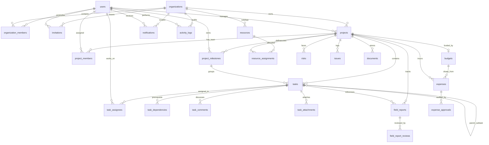

# FieldLedger — PostgreSQL Database Design & ER Diagram (Phase 1)

## 1. Design Principles

1. **Third Normal Form (3NF):** No monolithic tables and no dumping relational records into arbitrary JSON blobs. (`JSONB` is used strictly for structured audit snapshots like `activity_logs.metadata` and optional `organizations.settings`).
2. **UUID Primary Keys:** Every table uses `UUID PRIMARY KEY DEFAULT gen_random_uuid()` (built into PostgreSQL 13+, no extension required) so IDs are unpredictable in REST URLs.
3. **Strict Multi-Tenancy:** Every domain table references `organizations(id)` (directly or via `projects(id)`) with composite indexes starting with `organization_id` for fast isolated queries.
4. **Exact Financial Types:** All money columns use `NUMERIC(14, 2)` with `CHECK (amount >= 0)`.
5. **Timestamps & Auditability:** Every core table has `created_at TIMESTAMPTZ NOT NULL DEFAULT NOW()` and `updated_at TIMESTAMPTZ NOT NULL DEFAULT NOW()` maintained by a PostgreSQL trigger.
6. **Safe Delete Semantics:** Reference records use `ON DELETE RESTRICT` or `ON DELETE SET NULL` where audit history matters (e.g., never silently wipe an expense approval history), and `ON DELETE CASCADE` only for strictly owned child records (e.g., `task_assignees` when a task is deleted).

---

## 2. Entity-Relationship Diagram

---

## 3. Complete Table Specifications (24 Normalized Tables)

### Group A — Identity, Organizations & Invitations

#### 1. `users`
| Column | Type | Constraints / Notes |
| :--- | :--- | :--- |
| `id` | `UUID` | `PRIMARY KEY DEFAULT gen_random_uuid()` |
| `full_name` | `VARCHAR(120)` | `NOT NULL` |
| `email` | `VARCHAR(255)` | `NOT NULL UNIQUE` (stored lowercase) |
| `password_hash` | `TEXT` | `NOT NULL` (bcrypt hash) |
| `avatar_url` | `TEXT` | nullable |
| `job_title` | `VARCHAR(100)` | nullable |
| `phone` | `VARCHAR(30)` | nullable |
| `is_super_admin` | `BOOLEAN` | `NOT NULL DEFAULT FALSE` |
| `is_active` | `BOOLEAN` | `NOT NULL DEFAULT TRUE` |
| `last_login_at` | `TIMESTAMPTZ` | nullable |
| `created_at` / `updated_at` | `TIMESTAMPTZ` | `NOT NULL DEFAULT NOW()` |

#### 2. `organizations`
| Column | Type | Constraints / Notes |
| :--- | :--- | :--- |
| `id` | `UUID` | `PRIMARY KEY DEFAULT gen_random_uuid()` |
| `name` | `VARCHAR(150)` | `NOT NULL` |
| `slug` | `VARCHAR(160)` | `NOT NULL UNIQUE` |
| `industry` | `VARCHAR(80)` | nullable (NGO, Construction, University, SMB, etc.) |
| `description` | `TEXT` | nullable |
| `currency_code` | `CHAR(3)` | `NOT NULL DEFAULT 'USD'` |
| `timezone` | `VARCHAR(60)` | `NOT NULL DEFAULT 'UTC'` |
| `settings` | `JSONB` | `NOT NULL DEFAULT '{}'::jsonb` |
| `created_by` | `UUID` | `REFERENCES users(id) ON DELETE RESTRICT` |
| `created_at` / `updated_at` | `TIMESTAMPTZ` | `NOT NULL DEFAULT NOW()` |

#### 3. `organization_members`
| Column | Type | Constraints / Notes |
| :--- | :--- | :--- |
| `id` | `UUID` | `PRIMARY KEY DEFAULT gen_random_uuid()` |
| `organization_id` | `UUID` | `NOT NULL REFERENCES organizations(id) ON DELETE CASCADE` |
| `user_id` | `UUID` | `NOT NULL REFERENCES users(id) ON DELETE CASCADE` |
| `role` | `VARCHAR(30)` | `NOT NULL CHECK (role IN ('org_owner', 'project_manager', 'team_member', 'stakeholder'))` |
| `status` | `VARCHAR(20)` | `NOT NULL DEFAULT 'active' CHECK (status IN ('active', 'suspended'))` |
| `joined_at` | `TIMESTAMPTZ` | `NOT NULL DEFAULT NOW()` |
| **Unique** | | `UNIQUE (organization_id, user_id)` |

#### 4. `invitations`
| Column | Type | Constraints / Notes |
| :--- | :--- | :--- |
| `id` | `UUID` | `PRIMARY KEY DEFAULT gen_random_uuid()` |
| `organization_id` | `UUID` | `NOT NULL REFERENCES organizations(id) ON DELETE CASCADE` |
| `email` | `VARCHAR(255)` | `NOT NULL` |
| `role` | `VARCHAR(30)` | `NOT NULL CHECK (role IN ('org_owner', 'project_manager', 'team_member', 'stakeholder'))` |
| `token_hash` | `TEXT` | `NOT NULL UNIQUE` (SHA-256 hash of invite token) |
| `invited_by` | `UUID` | `NOT NULL REFERENCES users(id) ON DELETE RESTRICT` |
| `status` | `VARCHAR(20)` | `NOT NULL DEFAULT 'pending' CHECK (status IN ('pending', 'accepted', 'expired', 'revoked'))` |
| `expires_at` | `TIMESTAMPTZ` | `NOT NULL` |
| `accepted_at` | `TIMESTAMPTZ` | nullable |
| `created_at` | `TIMESTAMPTZ` | `NOT NULL DEFAULT NOW()` |

---

### Group B — Projects, Team & Milestones

#### 5. `projects`
| Column | Type | Constraints / Notes |
| :--- | :--- | :--- |
| `id` | `UUID` | `PRIMARY KEY DEFAULT gen_random_uuid()` |
| `organization_id` | `UUID` | `NOT NULL REFERENCES organizations(id) ON DELETE CASCADE` |
| `project_code` | `VARCHAR(32)` | `NOT NULL` (`UNIQUE (organization_id, project_code)`) |
| `name` | `VARCHAR(180)` | `NOT NULL` |
| `description` | `TEXT` | nullable |
| `status` | `VARCHAR(20)` | `NOT NULL DEFAULT 'planning' CHECK (status IN ('planning', 'active', 'on_hold', 'at_risk', 'completed', 'cancelled'))` |
| `priority` | `VARCHAR(20)` | `NOT NULL DEFAULT 'medium' CHECK (priority IN ('low', 'medium', 'high', 'critical'))` |
| `manager_id` | `UUID` | `REFERENCES users(id) ON DELETE SET NULL` |
| `location_name` | `VARCHAR(180)` | nullable (operating area / site name) |
| `latitude` | `NUMERIC(9, 6)` | nullable (optional site map pin) |
| `longitude` | `NUMERIC(9, 6)` | nullable (optional site map pin) |
| `start_date` | `DATE` | `NOT NULL` |
| `expected_end_date` | `DATE` | `NOT NULL CHECK (expected_end_date >= start_date)` |
| `actual_completion_date` | `DATE` | nullable |
| `objectives` | `TEXT` | nullable |
| `success_indicators` | `TEXT` | nullable |
| `is_archived` | `BOOLEAN` | `NOT NULL DEFAULT FALSE` |
| `created_by` | `UUID` | `NOT NULL REFERENCES users(id) ON DELETE RESTRICT` |
| `created_at` / `updated_at` | `TIMESTAMPTZ` | `NOT NULL DEFAULT NOW()` |

#### 6. `project_members`
| Column | Type | Constraints / Notes |
| :--- | :--- | :--- |
| `id` | `UUID` | `PRIMARY KEY DEFAULT gen_random_uuid()` |
| `organization_id` | `UUID` | `NOT NULL REFERENCES organizations(id) ON DELETE CASCADE` |
| `project_id` | `UUID` | `NOT NULL REFERENCES projects(id) ON DELETE CASCADE` |
| `user_id` | `UUID` | `NOT NULL REFERENCES users(id) ON DELETE CASCADE` |
| `project_role` | `VARCHAR(30)` | `NOT NULL CHECK (project_role IN ('manager', 'member', 'stakeholder'))` |
| `weekly_capacity_hours` | `NUMERIC(5, 2)` | `NOT NULL DEFAULT 40.00 CHECK (weekly_capacity_hours >= 0)` |
| `assigned_at` | `TIMESTAMPTZ` | `NOT NULL DEFAULT NOW()` |
| **Unique** | | `UNIQUE (project_id, user_id)` |

#### 7. `project_milestones`
| Column | Type | Constraints / Notes |
| :--- | :--- | :--- |
| `id` | `UUID` | `PRIMARY KEY DEFAULT gen_random_uuid()` |
| `organization_id` | `UUID` | `NOT NULL REFERENCES organizations(id) ON DELETE CASCADE` |
| `project_id` | `UUID` | `NOT NULL REFERENCES projects(id) ON DELETE CASCADE` |
| `owner_id` | `UUID` | `REFERENCES users(id) ON DELETE SET NULL` |
| `title` | `VARCHAR(180)` | `NOT NULL` |
| `description` | `TEXT` | nullable |
| `target_date` | `DATE` | `NOT NULL` |
| `completed_at` | `TIMESTAMPTZ` | nullable |
| `status` | `VARCHAR(20)` | `NOT NULL DEFAULT 'pending' CHECK (status IN ('pending', 'in_progress', 'completed', 'missed'))` |
| `created_at` / `updated_at` | `TIMESTAMPTZ` | `NOT NULL DEFAULT NOW()` |

---

### Group C — Advanced Tasks

#### 8. `tasks`
| Column | Type | Constraints / Notes |
| :--- | :--- | :--- |
| `id` | `UUID` | `PRIMARY KEY DEFAULT gen_random_uuid()` |
| `organization_id` | `UUID` | `NOT NULL REFERENCES organizations(id) ON DELETE CASCADE` |
| `project_id` | `UUID` | `NOT NULL REFERENCES projects(id) ON DELETE CASCADE` |
| `milestone_id` | `UUID` | `REFERENCES project_milestones(id) ON DELETE SET NULL` |
| `parent_task_id` | `UUID` | `REFERENCES tasks(id) ON DELETE CASCADE` (subtasks) |
| `creator_id` | `UUID` | `NOT NULL REFERENCES users(id) ON DELETE RESTRICT` |
| `title` | `VARCHAR(200)` | `NOT NULL` |
| `description` | `TEXT` | nullable |
| `priority` | `VARCHAR(20)` | `NOT NULL DEFAULT 'medium' CHECK (priority IN ('low', 'medium', 'high', 'critical'))` |
| `status` | `VARCHAR(20)` | `NOT NULL DEFAULT 'todo' CHECK (status IN ('backlog', 'todo', 'in_progress', 'blocked', 'in_review', 'completed'))` |
| `start_date` | `DATE` | nullable |
| `due_date` | `DATE` | nullable |
| `completed_at` | `TIMESTAMPTZ` | nullable |
| `estimated_hours` | `NUMERIC(6, 2)` | `CHECK (estimated_hours >= 0)` |
| `actual_hours` | `NUMERIC(6, 2)` | `NOT NULL DEFAULT 0 CHECK (actual_hours >= 0)` |
| `progress_percent` | `SMALLINT` | `NOT NULL DEFAULT 0 CHECK (progress_percent BETWEEN 0 AND 100)` |
| `labels` | `TEXT[]` | `NOT NULL DEFAULT '{}'` (PostgreSQL text array for simple tag filtering) |
| `created_at` / `updated_at` | `TIMESTAMPTZ` | `NOT NULL DEFAULT NOW()` |

#### 9. `task_assignees`
- `task_id` (`FK -> tasks.id ON DELETE CASCADE`), `user_id` (`FK -> users.id ON DELETE CASCADE`), `assigned_by`, `assigned_at`.
- `PRIMARY KEY (task_id, user_id)` — supports single or multi-assignee tasks cleanly.

#### 10. `task_dependencies`
- `id UUID PK`, `project_id UUID NOT NULL FK`, `task_id UUID NOT NULL FK`, `depends_on_task_id UUID NOT NULL FK`, `created_at`.
- `UNIQUE (task_id, depends_on_task_id)` and `CHECK (task_id <> depends_on_task_id)`.

#### 11. `task_comments`
- `id UUID PK`, `organization_id UUID FK`, `task_id UUID FK ON DELETE CASCADE`, `author_id UUID FK`, `body TEXT NOT NULL`, `created_at`, `updated_at`.

#### 12. `task_attachments`
- `id UUID PK`, `organization_id UUID FK`, `task_id UUID FK ON DELETE CASCADE`, `uploaded_by UUID FK`, `original_name VARCHAR(255)`, `stored_filename VARCHAR(255) UNIQUE`, `mime_type VARCHAR(100)`, `file_size_bytes BIGINT CHECK (file_size_bytes > 0)`, `created_at`.

---

### Group D — Field Activity Reports & Review Audit

#### 13. `field_reports`
| Column | Type | Constraints / Notes |
| :--- | :--- | :--- |
| `id` | `UUID` | `PRIMARY KEY DEFAULT gen_random_uuid()` |
| `organization_id` | `UUID` | `NOT NULL REFERENCES organizations(id) ON DELETE CASCADE` |
| `project_id` | `UUID` | `NOT NULL REFERENCES projects(id) ON DELETE CASCADE` |
| `task_id` | `UUID` | `REFERENCES tasks(id) ON DELETE SET NULL` |
| `submitted_by` | `UUID` | `NOT NULL REFERENCES users(id) ON DELETE RESTRICT` |
| `title` | `VARCHAR(200)` | `NOT NULL` |
| `activity_date` | `DATE` | `NOT NULL` |
| `location_name` | `VARCHAR(180)` | `NOT NULL` |
| `work_completed` | `TEXT` | `NOT NULL` |
| `challenges_blockers` | `TEXT` | nullable |
| `resources_used_summary` | `TEXT` | nullable |
| `progress_contribution_pct` | `NUMERIC(5, 2)` | `DEFAULT 0 CHECK (progress_contribution_pct BETWEEN 0 AND 100)` |
| `evidence_file_name` | `VARCHAR(255)` | nullable |
| `evidence_stored_path` | `VARCHAR(255)` | nullable |
| `evidence_mime_type` | `VARCHAR(100)` | nullable |
| `status` | `VARCHAR(20)` | `NOT NULL DEFAULT 'draft' CHECK (status IN ('draft', 'submitted', 'under_review', 'approved', 'rejected'))` |
| `submitted_at` | `TIMESTAMPTZ` | nullable |
| `reviewed_by` | `UUID` | `REFERENCES users(id) ON DELETE SET NULL` |
| `reviewed_at` | `TIMESTAMPTZ` | nullable |
| `created_at` / `updated_at` | `TIMESTAMPTZ` | `NOT NULL DEFAULT NOW()` |

#### 14. `field_report_reviews`
- Immutable review audit trail: `id`, `organization_id`, `field_report_id FK ON DELETE CASCADE`, `reviewer_id FK`, `previous_status`, `new_status`, `review_notes TEXT`, `reviewed_at TIMESTAMPTZ NOT NULL DEFAULT NOW()`.

---

### Group E — Budgets, Expenses & Resources

#### 15. `budgets`
- `id`, `organization_id`, `project_id UNIQUE FK ON DELETE CASCADE`, `planned_amount NUMERIC(14, 2) NOT NULL CHECK (planned_amount >= 0)`, `currency_code CHAR(3) DEFAULT 'USD'`, `contingency_amount NUMERIC(14, 2) NOT NULL DEFAULT 0`, `notes TEXT`, `created_by`, `created_at`, `updated_at`.

#### 16. `expenses`
- `id`, `organization_id`, `project_id FK`, `budget_id FK`, `submitted_by FK`, `title VARCHAR(180) NOT NULL`, `category VARCHAR(60) NOT NULL` (`materials`, `labor`, `equipment`, `transport`, `permits`, `other`), `expense_date DATE NOT NULL`, `amount NUMERIC(14, 2) NOT NULL CHECK (amount > 0)`, `vendor_name VARCHAR(150)`, `description TEXT`, `receipt_original_name`, `receipt_stored_path`, `receipt_mime_type`, `status VARCHAR(20) NOT NULL DEFAULT 'pending' CHECK (status IN ('pending', 'approved', 'rejected'))`, `created_at`, `updated_at`.

#### 17. `expense_approvals`
- Immutable approval audit log: `id`, `organization_id`, `expense_id FK ON DELETE CASCADE`, `approver_id FK`, `decision VARCHAR(20) CHECK (decision IN ('approved', 'rejected'))`, `comments TEXT`, `decided_at TIMESTAMPTZ NOT NULL DEFAULT NOW()`.

#### 18. `resources`
- `id`, `organization_id`, `name VARCHAR(150) NOT NULL`, `resource_type VARCHAR(40) CHECK (resource_type IN ('equipment', 'material', 'vehicle', 'tool', 'software', 'other'))`, `unit VARCHAR(30) NOT NULL`, `total_quantity NUMERIC(12, 2) NOT NULL CHECK (total_quantity >= 0)`, `available_quantity NUMERIC(12, 2) NOT NULL CHECK (available_quantity >= 0)`, `min_threshold NUMERIC(12, 2) NOT NULL DEFAULT 0`, `unit_cost NUMERIC(14, 2) DEFAULT 0`, `status VARCHAR(20) DEFAULT 'available'`, `created_at`, `updated_at`.

#### 19. `resource_assignments`
- `id`, `organization_id`, `resource_id FK ON DELETE RESTRICT`, `project_id FK ON DELETE CASCADE`, `assigned_by FK`, `quantity_allocated NUMERIC(12, 2) NOT NULL CHECK (quantity_allocated > 0)`, `quantity_used NUMERIC(12, 2) NOT NULL DEFAULT 0 CHECK (quantity_used >= 0)`, `start_date DATE`, `end_date DATE`, `status VARCHAR(20) DEFAULT 'active' CHECK (status IN ('active', 'returned', 'consumed'))`, `notes TEXT`, `created_at`, `updated_at`.

---

### Group F — Risks, Issues, Documents, Notifications & Audit

#### 20. `risks`
- `id`, `organization_id`, `project_id FK ON DELETE CASCADE`, `owner_id FK`, `title VARCHAR(200) NOT NULL`, `description TEXT NOT NULL`, `probability SMALLINT NOT NULL CHECK (probability BETWEEN 1 AND 5)`, `impact SMALLINT NOT NULL CHECK (impact BETWEEN 1 AND 5)`, `severity SMALLINT GENERATED ALWAYS AS (probability * impact) STORED`, `mitigation_plan TEXT`, `review_date DATE`, `status VARCHAR(20) NOT NULL DEFAULT 'identified' CHECK (status IN ('identified', 'monitoring', 'mitigated', 'occurred', 'closed'))`, `created_by`, `created_at`, `updated_at`.

#### 21. `issues`
- `id`, `organization_id`, `project_id FK ON DELETE CASCADE`, `task_id FK ON DELETE SET NULL`, `reported_by FK`, `assigned_to FK`, `title VARCHAR(200) NOT NULL`, `description TEXT NOT NULL`, `severity VARCHAR(20) NOT NULL CHECK (severity IN ('low', 'medium', 'high', 'critical'))`, `status VARCHAR(20) NOT NULL DEFAULT 'open' CHECK (status IN ('open', 'investigating', 'resolved', 'closed'))`, `resolution_notes TEXT`, `resolved_at TIMESTAMPTZ`, `created_at`, `updated_at`.

#### 22. `documents`
- `id`, `organization_id`, `project_id FK ON DELETE CASCADE`, `uploaded_by FK`, `title VARCHAR(200) NOT NULL`, `category VARCHAR(50) DEFAULT 'general'`, `original_name`, `stored_filename UNIQUE`, `mime_type`, `file_size_bytes BIGINT`, `version INTEGER NOT NULL DEFAULT 1`, `created_at`, `updated_at`.

#### 23. `notifications`
- `id`, `organization_id`, `recipient_id FK ON DELETE CASCADE`, `type VARCHAR(50) NOT NULL` (`task_assigned`, `task_overdue`, `milestone_due`, `report_submitted`, `report_reviewed`, `expense_reviewed`, `risk_high`), `title VARCHAR(200) NOT NULL`, `message TEXT NOT NULL`, `entity_type VARCHAR(50)`, `entity_id UUID`, `is_read BOOLEAN NOT NULL DEFAULT FALSE`, `read_at TIMESTAMPTZ`, `created_at`.

#### 24. `activity_logs`
- `id`, `organization_id`, `project_id UUID REFERENCES projects(id) ON DELETE SET NULL`, `actor_id UUID REFERENCES users(id) ON DELETE SET NULL`, `action VARCHAR(80) NOT NULL` (e.g., `task.created`, `field_report.approved`, `expense.rejected`), `entity_type VARCHAR(50) NOT NULL`, `entity_id UUID NOT NULL`, `summary TEXT NOT NULL`, `metadata JSONB NOT NULL DEFAULT '{}'::jsonb`, `created_at TIMESTAMPTZ NOT NULL DEFAULT NOW()`.

---

## 4. Key Indexing Strategy

- `idx_org_members_user_org` on `organization_members (user_id, organization_id)`
- `idx_projects_org_status` on `projects (organization_id, status) WHERE is_archived = FALSE`
- `idx_tasks_org_project_status` on `tasks (organization_id, project_id, status)`
- `idx_tasks_due_date` on `tasks (organization_id, due_date) WHERE status <> 'completed'` (powers overdue alerts fast)
- `idx_field_reports_org_status` on `field_reports (organization_id, project_id, status, activity_date DESC)`
- `idx_expenses_org_project_status` on `expenses (organization_id, project_id, status)`
- `idx_risks_org_severity` on `risks (organization_id, project_id, severity DESC)`
- `idx_notifications_recipient_unread` on `notifications (recipient_id, is_read, created_at DESC)`
- `idx_activity_logs_org_project_time` on `activity_logs (organization_id, project_id, created_at DESC)`
